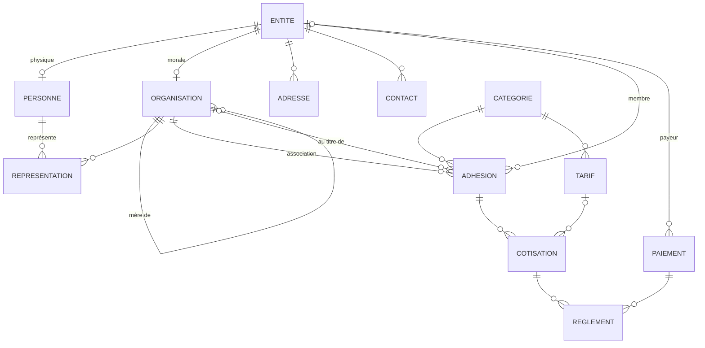

# Gestion des membres : modèle de données

Première brique de l'outil de gestion du club JaXaJ MC. Elle sert d'annuaire, de registre des adhésions et des cotisations, et de référence pour le contrôle d'accès aux événements. D'autres applications du club (agenda et calendrier, événements, cuisine, comptabilité…) s'appuieront dessus : le modèle est pensé pour être consommé par elles, pas seulement par une interface.

## Choix du SGBDR : PostgreSQL

- Un schéma par application dans un même serveur : chaque appli possède ses tables et ses droits, et expose aux autres des vues ou des fonctions. On garde une séparation nette sans multiplier les serveurs, et une appli pourra être détachée plus tard.
- Contraintes d'exclusion sur des périodes : impossible d'avoir deux adhésions qui se chevauchent, deux présidents en même temps ou deux tarifs pour la même période. Ces règles sont garanties par la base, quelle que soit l'appli qui écrit.
- Sécurité par ligne si un chapitre ne doit voir que ses membres, notifications (`LISTEN/NOTIFY`) pour prévenir les autres applis d'un changement, UUID, JSONB.
- L'API de 2021 visait déjà PostgreSQL, et il est installé sur la Dédibox.

Version : 13 au minimum (`gen_random_uuid` intégré). Le PostgreSQL 11 de la Dédibox n'est plus maintenu depuis 2023 et Debian 10 ne reçoit plus de versions récentes : il faudra soit mettre à jour Debian, soit faire tourner un PostgreSQL récent dans un conteneur. Le schéma est testé avec PostgreSQL 15.

## Principes communs à toutes les applications

- Chaque entité a un identifiant UUID stable. Une autre appli référence un membre par cet UUID, jamais par un identifiant interne ou un nom.
- On historise par des périodes (`daterange`) au lieu d'écraser : catégorie de membre, fonction, tarif.
- Une appli est seule à écrire dans ses tables ; les autres passent par son API ou par les vues et fonctions qu'elle publie.
- Données personnelles (RGPD) : `annuaire.entite.anonymise_le` marque une fiche dont les données personnelles ont été effacées, l'historique des adhésions et des paiements restant exploitable.

## Le modèle

### Schéma `annuaire`

- `entite` : toute personne, physique ou morale. Les adhésions et les coordonnées pointent ici, ce qui permet à une association d'être membre d'une autre : les chapitres Béarn et Euskadi sont les deux membres de l'association mère.
- `personne` et `organisation` : les détails propres à chaque nature. Une organisation a un genre (`association_jaxaj`, `club_moto`, `association`…) et éventuellement une association mère.
- `adresse` et `contact` : plusieurs par entité, une principale par type. Le code postal est un texte et le pays un code ISO à deux lettres.
- `representation` : qui représente quelle organisation, à quel titre et quand. Le président de chaque chapitre (qui le représente auprès de la mère), le trésorier, ou une personne venue sous l'égide de son club ou de son association moto.

### Schéma `adhesion`

- `categorie` : full patch, observateur, suiveur, support (membres du club), public (adhérent aux événements), association (membre de la mère).
- `tarif` : montant par catégorie et périodicité (mensuelle, annuelle, ponctuelle), sur une période de validité, avec la décision qui l'a fixé. Sans association, le tarif vaut pour tous les chapitres ; un tarif propre à une association l'emporte. Les tarifs de 2026 sont repris pour 2027 en attendant l'AG de janvier.
- `adhesion` : tel membre, à telle association, dans telle catégorie, sur telle période, éventuellement au titre d'un club ou d'une association. Passer de suiveur à full patch, c'est clore une adhésion et en ouvrir une autre.
- `cotisation` : ce qui est dû pour une période (un mois, une année, un événement), au montant du tarif applicable, ou gratuite.
- `paiement` et `reglement` : un paiement (espèces, chèque, virement, carte, en ligne) encaissé par une association, réparti sur une ou plusieurs cotisations.

### Ce que les autres applications utilisent

- `adhesion.droit_acces(membre, jour, associations)` : le membre a-t-il une cotisation réglée ou gratuite à cette date ? C'est la question posée à l'entrée d'un événement.
- `adhesion.tarif_applicable(categorie, periodicite, jour, association)` : le tarif en vigueur.
- `adhesion.cotisation_etat` : chaque cotisation avec ce qui est réglé et le solde.

## Reprise de l'ancienne base (Free, 2009-2020)

| Ancien | Nouveau |
|---|---|
| `prod_membres` | `entite` + `personne`, `adresse`, `contact` (téléphone) |
| `Pays` (texte) | code ISO (`France` → `FR`, `Espagne` → `ES`…) |
| `Code_post` (nombre) | texte, complété à 5 chiffres pour la France et l'Espagne |
| `Type` Support | adhésion `public` |
| `Type` Club, Association | adhésion `public` au titre d'une organisation, à identifier dans les commentaires |
| `Type` Membre, Suiveur, Observateur | adhésion de la catégorie correspondante |
| `Date_insc` | début de la première adhésion |
| `prod_cotisations` mensuelle | cotisation sur le mois, tarif public 5 € |
| `prod_cotisations` annuelle (mois vide) | cotisation sur l'année, tarif public 20 € |
| `Gratuit` | cotisation gratuite |
| `ID_membre` | conservé dans une table de correspondance, pour la traçabilité |

Toutes les adhésions reprises sont rattachées à l'association mère, le seul chapitre de l'époque. Les cotisations reprises n'ont pas de paiement associé : l'ancienne base ne savait que « payé » ou « gratuit ». Elles seront marquées réglées par un paiement global de reprise. Les doublons possibles (même nom, prénom et date de naissance) sont signalés dans le rapport, pas fusionnés automatiquement.

Le script `reprise/reprise_free.py` produit le SQL de reprise et un rapport, à écrire hors du dépôt car ils contiennent les données personnelles. Résultat sur l'export du 18/11/2026 : 955 personnes, 904 adresses, 855 téléphones, 955 adhésions, 1 339 cotisations sur 1 345 (une sans année, quatre recouvertes par une cotisation annuelle, une en double), aucune incohérence au chargement.

## Décisions (18/11/2026)

- Association mère : JaXaJ MC.
- Deux catégories distinctes : `support`, membre du club validé par lui, et `public`, personne qui a seulement adhéré pour entrer à un événement. L'ancienne base appelait ce public « Support » : il est repris en `public`. Le libellé affiché de `public` reste à choisir.
- Pas de formule annuelle pour les membres du club pour l'instant : cotisations mensuelles.
- Les reversements des chapitres à la mère et les statistiques relèveront d'une appli de suivi plus tard. Le modèle garde ce qu'il faut pour les calculer : chaque cotisation, son tarif, chaque paiement et l'association qui l'a encaissé.

## Questions ouvertes

- Libellé de la catégorie `public` (« Public », « Adhérent événement », « Visiteur »…).
- Montants 2026 à confirmer.
- Qui se connecte, et à quoi : le bureau de chaque chapitre, les personnes à l'entrée, les membres pour leur fiche. C'est la brique suivante (comptes et droits), qui servira à toutes les applis.
